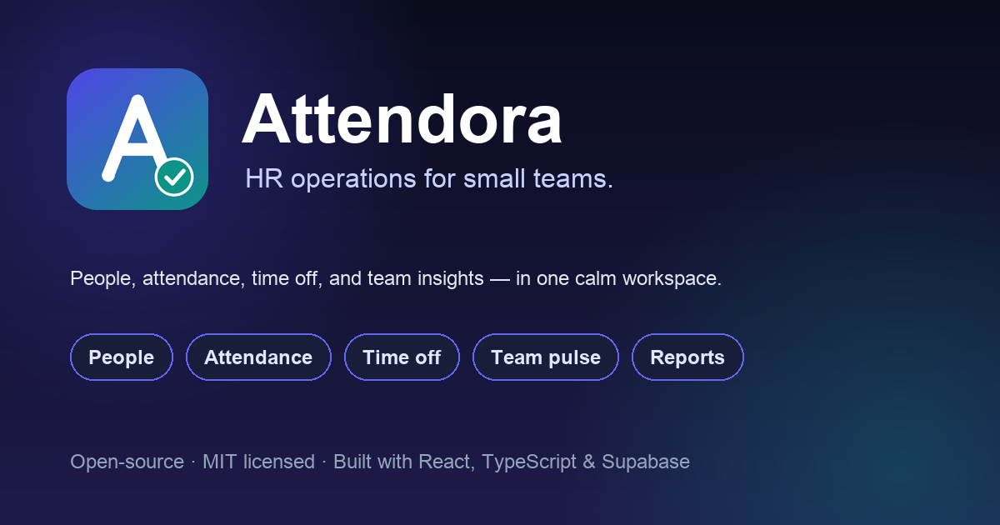

<p align="center">
  
</p>

<h1 align="center">Attendora</h1>

<p align="center">
  <strong>HR operations for small teams.</strong><br />
  People, attendance, time off, and team insights in one calm workspace.
</p>

<p align="center">
  <a href="./LICENSE"></a>
  
  
  
  
</p>

<p align="center">
  
</p>

---

## What is Attendora?

Attendora is an open-source HR platform for teams of roughly 10–20 people. It replaces the
spreadsheet, the chat thread, and the "who approved this?" email chain with a focused product:
a people directory, attendance, time off, corrections, reports, and a privacy-first weekly
team pulse.

It is built as a **single-page React app backed entirely by Supabase** — Postgres, Row Level
Security, Auth, Storage, and Edge Functions. There is no separate Node/Express server to deploy
or maintain.

> Attendora is an independent open-source project, designed and built by
> [Huzefa Mandviwala](https://github.com/Huzefman).

---

## Why I built Attendora

I built Attendora for small teams that have outgrown spreadsheets but do not need an enterprise
HR suite. The goals were simple:

- make the daily flows — check-in, time off, corrections — fast enough to use without training
- put privacy in the architecture, not in a settings page
- keep the stack small enough that one person can understand, run, and change it

React and Supabase were the right fit: a typed frontend, Postgres RLS for authorization, and
Edge Functions for the few things that must happen on the server.

---

## Features

| Area | What you get |
|---|---|
| **People** | Profiles, departments, designations, reporting lines, documents, bank details, lifecycle events, onboarding checklists, profile-change requests, CSV export |
| **Attendance** | Check-in/out, WFH, shifts, weekly offs, late detection, half-days, early-checkout approval, corrections, manual entries, team grid, daily reports, CSV export |
| **Time off** | Configurable types, balances, accruals, half-days, holidays, optional holidays, cancellation requests, SLA escalation, year-end rollover, reports |
| **Team Pulse** | Optional weekly check-in (1–5). Employees see their own history; owner/HR see weekly averages and participation only |
| **Insights** | Attendance summaries, absence rates, headcount, regularization log, department heatmap, daily attendance |
| **Workspace** | Role-based navigation, command palette (`⌘K` / `Ctrl K`), light/dark themes, PWA install, in-app notifications, email notifications |
| **Privacy controls** | RLS on every table, soft geofence by default, configurable location policy, aggregate-only pulse data, no third-party analytics |

### What makes it different

- **Soft location, not a locked door.** The default attendance policy is `flag`: people can check
  in even when GPS is unavailable, and the record is quietly marked for review. `strict` is
  available, but it is not the default. Location is never stored when the policy is `off`.
- **Team pulse, not surveillance.** One optional check-in a week. Admins get an aggregate trend
  and participation rate. Individual scores and notes are protected by RLS and never exposed
  through a row-level admin policy.
- **Command-first navigation.** A `⌘K` palette searches pages, people, and quick actions.
- **A focused shell.** A dark navigation rail, a single content column, and a public landing
  page keep the daily flows close at hand.

---

## Tech stack

- **Frontend:** React 18, TypeScript, Vite, Tailwind CSS, shadcn/ui, Radix UI, TanStack Query,
  React Hook Form + Zod, Lucide icons, Leaflet
- **Backend:** Supabase Postgres, Row Level Security, Auth, Storage, Edge Functions (Deno)
- **Email:** Resend (optional)
- **Push:** Web Push / VAPID (optional)
- **No** Express, FastAPI, Prisma, axios, or separate API server

---

## Quick start

### 0. Prerequisites

- Node.js 20+ (22 recommended)
- A Supabase project ([supabase.com](https://supabase.com))
- Supabase CLI via `npx supabase` (no global install required)

### 1. Clone and install

```bash
git clone https://github.com/Huzefman/attendora.git
cd attendora
npm install
```

### 2. Configure environment

```bash
cp .env.example .env.local
```

Fill in at minimum:

```dotenv
VITE_SUPABASE_URL=https://<project-ref>.supabase.co
VITE_SUPABASE_ANON_KEY=<anon-key>
SUPABASE_URL=https://<project-ref>.supabase.co
SUPABASE_SERVICE_ROLE_KEY=<service-role-key>
BOOTSTRAP_OWNER_EMAIL=you@example.com
BOOTSTRAP_OWNER_PASSWORD=<at-least-12-characters>
```

### 3. Apply the database schema

Link the project and push the migrations:

```bash
npx supabase link --project-ref <project-ref>
npx supabase db push
```

Then run `supabase/seed.sql` in the Supabase SQL editor (or `npx supabase db reset` for a local
stack) to load the default `app_config` rows.

### 4. Create the first owner

```bash
npm run bootstrap:owner
```

This creates a Supabase Auth user and the matching `employees` row with `role = 'owner'`. It is
safe to re-run.

### 5. Local demo data (optional)

```bash
# Add DEMO_PASSWORD to .env.local first (12+ characters)
npm run seed:demo
```

This creates fictional people at `example.com`, a standard shift, three time-off types, holidays,
attendance rows for the previous ten weekdays, time-off requests, announcements, onboarding
items, and six weeks of Team Pulse responses. It sends **no** emails or push notifications.

See [docs/DEMO_DATA.md](./docs/DEMO_DATA.md) for the demo accounts, what is created, and how to
reset it. The seed refuses to run on a project with more than one employee unless you pass
`--force`; it is intended for new, disposable projects.

### 6. Deploy Edge Functions

```bash
npx supabase functions deploy
```

Set the function secrets in the Supabase dashboard (or with `npx supabase secrets set`):

```dotenv
APP_NAME=Attendora
SITE_URL=https://your-app.example.com
SUPPORT_EMAIL=support@example.com
EMAIL_FROM="Attendora <noreply@example.com>"
RESEND_API_KEY=<optional>
VAPID_PUBLIC_KEY=<optional>
VAPID_PRIVATE_KEY=<optional>
```

The app works without Resend or VAPID keys; email/push are skipped when keys are absent.

### 7. Run it

```bash
npm run dev
```

Open `http://localhost:5173`. The public landing page is at `/`, and the app is at `/login`.

### Preview the interface without a backend

If you only want to click through Attendora — no Supabase project, migrations, or environment
values — run:

```bash
npm run dev:preview
```

Open **http://localhost:5173/dashboard**. This starts Vite with an in-memory Supabase shim and
synthetic fixture data. Auth is simulated, Edge Function calls are stubbed, and no request leaves
the browser. The public landing page is at `/`; the split-screen sign-in is at `/login`.

Use any password with one of these demo accounts:

| Email | Role |
|---|---|
| `demo.owner@example.com` | Owner |
| `priya@example.com` | HR |
| `sam@example.com` | Employee |

Deep links work while the preview is open. Sign out from the avatar menu to switch roles. Preview
changes live in memory and reset on a full reload. The mode is enabled only by the
`dev:preview` script and is not intended for a production deployment.

---

## Scripts

| Command | What it does |
|---|---|
| `npm run dev` | Start Vite |
| `npm run dev:preview` | Start Vite with synthetic data and no backend |
| `npm run build` | Type-check and build for production |
| `npm run preview` | Preview the production build |
| `npm run typecheck` | `tsc --noEmit` |
| `npm run lint` | ESLint |
| `npm run ci` | Typecheck + lint + build |
| `npm run bootstrap:owner` | Create/update the first owner |
| `npm run seed:demo` | Load the synthetic demo workspace |
| `npm run types:gen` | Regenerate Supabase types (local stack) |

---

## Roles

| Role | Scope |
|---|---|
| `owner` | Full workspace, settings, roles, reports, audit log |
| `hr` | People, attendance, time off, corrections, reports |
| `employee` | Own profile, attendance, time off, pulse, own reports |
| `system_admin` | Infrastructure-facing settings (network rules, geofence, audit), limited people data |

RLS is enforced in Postgres. The frontend hides what a role cannot use, but hiding is never the
security boundary.

---

## Privacy and security

- Every table has RLS enabled. Policies live in `supabase/migrations/`.
- `pulse_responses` has no admin row policy. Owner/HR use `get_pulse_summary()`, a
  `security definer` function that returns aggregates only.
- Location policy is configurable: `off`, `flag` (default), or `strict`.
- Document access uses short-lived presigned URLs; storage buckets are private.
- No analytics SDK, ad pixel, or third-party CRM is included.
- Secrets belong in `.env.local` or Supabase secrets — never in git.

See [SECURITY.md](./SECURITY.md) for the disclosure policy and [docs/ROLE_RULES.md](./docs/ROLE_RULES.md)
for the policy matrix.

---

## Project structure

```text
src/
  components/layout/       App shell: sidebar, header, command palette, guards
  components/ui/           shadcn/ui primitives
  features/<domain>/       API, hooks, mutations, schemas, components
  pages/                   Thin route-level pages
  hooks/                   Auth, role, media query, toast
  lib/                     Supabase client, query client, brand, edge helper
  types/                   Generated DB types + app types
supabase/
  migrations/              Numbered SQL migrations
  functions/               Edge Functions (Deno)
    _shared/               auth, response, email, push, shift, attendance, geo, config
  seed.sql                 Default app_config
scripts/
  bootstrap-owner.mjs
  seed-demo.mjs
docs/                      Architecture, schema, business rules, roles, screens
```

---

## Documentation

- [Setup guide](./docs/SETUP.md) — a longer setup guide
- [Development handbook](./docs/DEVELOPMENT.md) — commands, conventions, and guardrails
- [Demo data](./docs/DEMO_DATA.md) — what the seed creates and how to reset it
- [Architecture](./docs/ARCHITECTURE.md)
- [Database schema](./docs/DATABASE_SCHEMA.md)
- [Business rules](./docs/BUSINESS_RULES.md)
- [Role rules & RLS](./docs/ROLE_RULES.md)
- [Screen inventory](./docs/SCREEN_INVENTORY.md)
- [Edge Function contracts](./docs/EDGE_FUNCTIONS.md)
- [Conventions](./CONVENTIONS.md)
- [Environment variables](./ENV.md)

---

## Contributing

Issues and pull requests are welcome. Read [CONTRIBUTING.md](./CONTRIBUTING.md) first. Please do
not include real employee data, credentials, or screenshots containing personal information in
issues or pull requests.

---

## License

MIT © 2026 Huzefa Mandviwala. See [LICENSE](./LICENSE).

Third-party dependencies retain their own licenses; see [THIRD_PARTY_NOTICES.md](./THIRD_PARTY_NOTICES.md).
